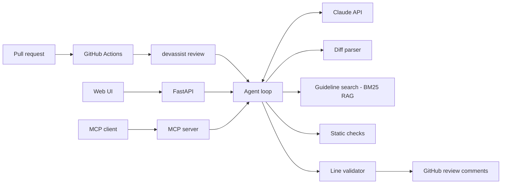

# DevAssist

[](https://github.com/YOUR_USERNAME/devassist/actions/workflows/ci.yml)
 

An AI code review agent for GitHub pull requests. It reads the diff, checks it against your team's coding guidelines (RAG), runs deterministic security checks, and posts line-level review comments, all from a GitHub Actions workflow.

**Live demo:** _add your deployed URL here_

## What it does

- **Tool-using LLM agent.** Claude decides which tools to call (`list_changed_files`, `get_file_diff`, `search_guidelines`, `run_static_checks`) and finishes with a structured `submit_review` call.
- **RAG over guidelines.** Markdown guidelines are chunked by heading and indexed with BM25 (no vector DB needed). Comments cite the guideline they come from.
- **Hallucination guard.** Every comment is validated against the parsed diff. A comment on a line that isn't in the PR is dropped before posting.
- **Graceful degradation.** No API key, rate limit or outage: it falls back to the rule engine instead of failing your CI.
- **Prompt-injection aware.** The diff is treated as untrusted data and the agent has no write tools beyond posting a review.
- **Three interfaces.** GitHub Action, web UI + REST API (FastAPI), and an MCP server for Claude Desktop.

## Architecture



## Quick start

```bash
git clone https://github.com/YOUR_USERNAME/devassist && cd devassist
python -m venv .venv && source .venv/bin/activate
pip install -e ".[dev,mcp]"
cp .env.example .env      # add ANTHROPIC_API_KEY (optional: works offline without it)

devassist serve           # web UI at http://localhost:8000
devassist review-diff change.diff
devassist review --repo owner/name --pr 12 --dry-run
```

Without `ANTHROPIC_API_KEY` DevAssist runs in rule-based mode, so you can try everything immediately.

## Run it on every pull request

1. Add the repository secret `ANTHROPIC_API_KEY` (Settings > Secrets and variables > Actions).
2. Keep `.github/workflows/review.yml`. It uses the built-in `GITHUB_TOKEN` with `pull-requests: write`.
3. Open a PR. DevAssist posts a review with inline comments.

PRs from forks don't receive secrets, so the workflow skips them by design.

## Use it from Claude Desktop (MCP)

```json
{ "mcpServers": { "devassist": { "command": "devassist-mcp", "env": { "ANTHROPIC_API_KEY": "...", "GITHUB_TOKEN": "..." } } } }
```

Tools: `review_diff`, `review_pr`, `search_guidelines`.

## Deploy

**Render (free tier):** New > Blueprint > select this repo (`render.yaml` is included), then set `ANTHROPIC_API_KEY`.
**Docker:** `docker build -t devassist . && docker run -p 8000:8000 -e ANTHROPIC_API_KEY=... devassist`

The public API is rate limited to 20 reviews per client per minute.

## Customize the guidelines

Drop markdown files into a folder and set `DEVASSIST_GUIDELINES=./my-guidelines`. Each `##` heading becomes a retrievable chunk.

## Evaluation

```bash
python -m evals.run_evals            # rule engine, deterministic, runs in CI
python -m evals.run_evals --llm      # Claude agent (needs ANTHROPIC_API_KEY)
```

| Suite | Cases | Recall | Precision |
|---|---|---|---|
| Rule engine (labelled PRs with planted issues) | 10 | 100% | 100% |

The dataset is small and synthetic, so treat these numbers as a regression guard, not a benchmark. CI fails if recall or precision drops under 90%. Run `--llm` on your own repositories and record the numbers here.

## Project layout

```
src/devassist/
  agent.py          tool-use loop, validation, fallback
  tools.py          tool schemas and executors
  diff_parser.py    unified diff -> valid comment lines
  rag/retriever.py  markdown chunking + BM25
  static_checks.py  13 security / bug / style rules
  github_client.py  fetch diff, post review (with fallback)
  server.py         FastAPI app + web UI
  mcp_server.py     MCP tools
  guidelines/       default team guidelines
evals/              labelled dataset + metrics
tests/              pytest suite (agent tested with a fake LLM)
```

## Limitations and next steps

- BM25 retrieval is lexical. Swap in embeddings (`rag/retriever.py` is the only file to change) for larger guideline sets.
- Reviews are per PR, not per commit, and don't yet resolve threads when issues are fixed.
- Static rules are regex based. Replace them with semgrep or ruff output for deeper coverage.

MIT licensed.
